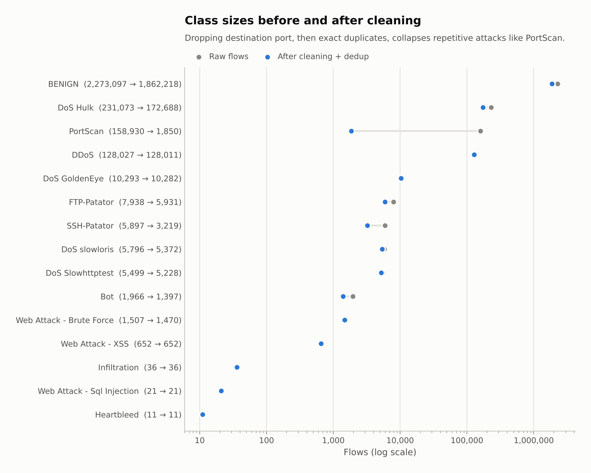
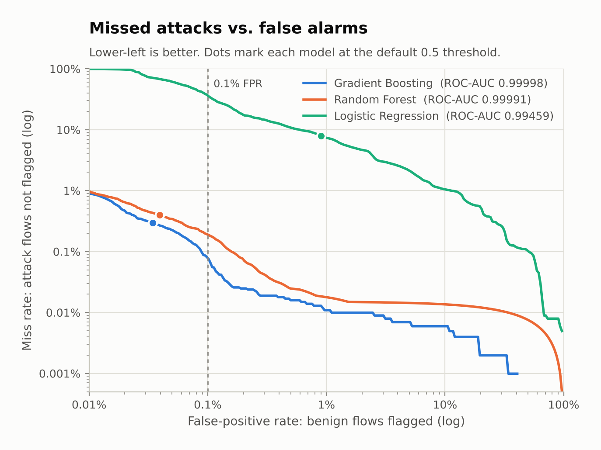
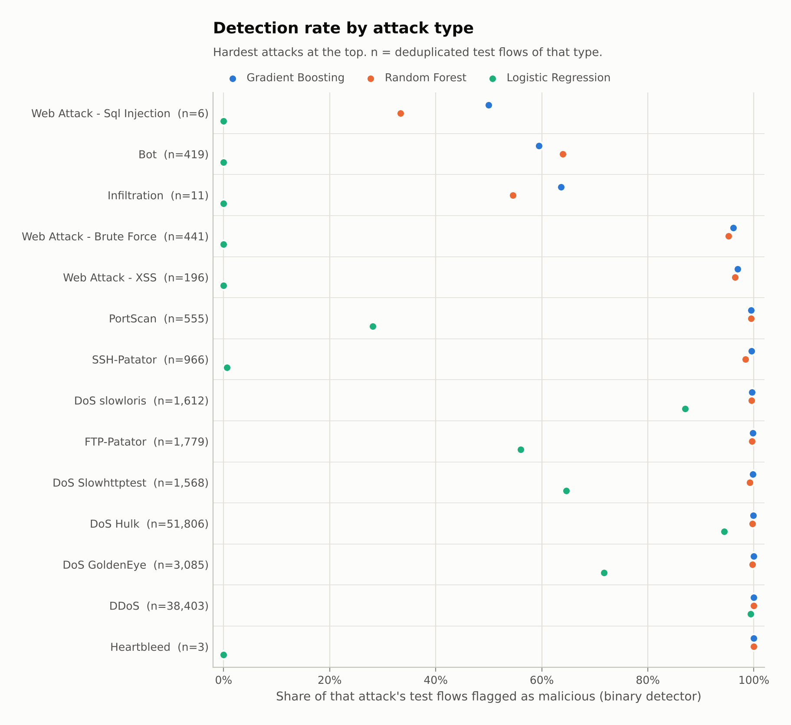
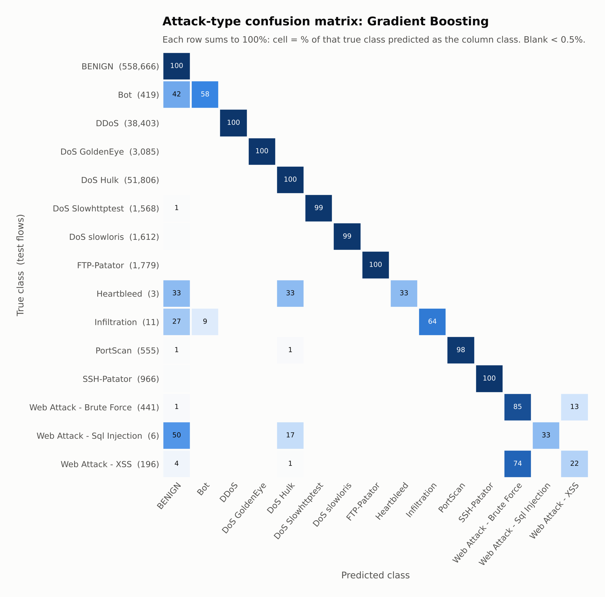
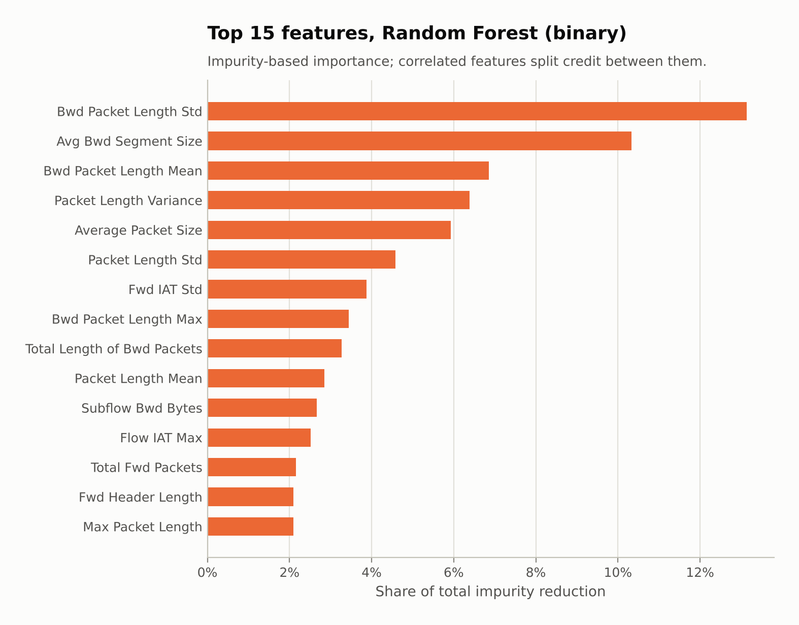

# ML-Based Network Intrusion Detection (CIC-IDS2017)

Flow-based intrusion detection on the [CIC-IDS2017](https://www.unb.ca/cic/datasets/ids-2017.html) dataset with scikit-learn. The pipeline cleans and deduplicates 2.8M labelled network flows, trains three classifiers to separate benign traffic from 14 attack types, and reports the numbers an analyst cares about: **detection rate, false-positive rate, and which attacks get missed and why**.

| Best model: Gradient Boosting, binary (benign vs. attack) | |
|---|---|
| Accuracy | **99.93%** |
| Detection rate (attack recall) | **99.71%** |
| False-positive rate | **0.034%** (192 false alarms out of 558,666 benign test flows) |
| F1 / ROC-AUC | 0.9976 / 0.99998 |
| Held-out test set | 659,516 flows (30% stratified split, no duplicates shared with training) |

## Key findings

1. **Tree ensembles beat the linear baseline by a wide margin.** Gradient boosting and random forest both reach about 99.6–99.7% detection at under 0.04% FPR. Logistic regression gets 92% detection at a 26× higher FPR (0.90%) and misses nearly every web, bot, infiltration and SSH brute-force attack.
2. **The hardest attacks to detect are Bot, Infiltration and SQL injection** (59%, 64% and 3 of 6 test flows detected). Botnet command-and-control flows tend to look like ordinary web requests at the flow level, and the other two have only 36 and 21 examples in the entire dataset. At the attack-type level, **XSS is mostly misclassified as web brute force** (74% of XSS flows), because the two differ in payload, which flow statistics don't capture. Details in [Hardest attacks and why](#hardest-attacks-and-why).
3. **Destination port is a shortcut, so it's excluded.** Every Infiltration flow targets port 444 and most Bot flows target 8080. Adding the port raises Bot detection from 59% to 73%, but the model would be learning this testbed's port choices, not attacker behaviour.
4. **Deduplication matters.** About 12% of flows are exact duplicates (22% once the port is dropped). Without dedup, 13.9% of test flows have an identical copy in the training set, and 6,790 flows share identical features with a flow of a different label. Those conflicts become unavoidable errors and **double the false-positive rate** (0.034% → 0.076%).

## Dataset

CIC-IDS2017 (Canadian Institute for Cybersecurity, [Sharafaldin et al., 2018](https://doi.org/10.5220/0006639801080116)) captures five days of traffic on a lab network with benign background users and scripted attacks. This project uses the `MachineLearningCSV` release: 2,830,743 flows, each described by 78 statistics from CICFlowMeter (packet lengths, inter-arrival times, flag counts, etc.) plus a label.

### Cleaning

| Step | Removed | Remaining |
|---|---|---|
| Raw data (8 CSV files) | | 2,830,743 flows × 78 features |
| Drop duplicated `Fwd Header Length` column | 1 column | 77 features |
| Drop `Destination Port` (shortcut feature, see above) | 1 column | 76 features |
| Fix mis-encoded web-attack labels (`Web Attack � XSS` → `Web Attack - XSS`) | | |
| Drop rows with NaN / ±inf (`Flow Bytes/s`, `Flow Packets/s`) | 2,867 rows | |
| Drop constant columns (the six bulk-transfer features, `Bwd PSH/URG Flags`) | 8 columns | 68 features |
| Drop exact duplicate rows (features + label) | 628,872 rows | |
| Drop rows whose features appear with more than one label | 618 rows | **2,198,386 flows × 68 features** |

Deduplication runs *after* the port is dropped, so no identical feature vector can appear in both the training and test sets. This has a large effect on PortScan: 158,930 raw flows collapse to 1,850 unique ones, because a port scan sends the same probe to many ports.



## Method

- **Split:** 70/30 train/test, stratified on the attack label so every class appears in both halves (seed 42). The test set holds 558,666 benign and 100,850 attack flows.
- **Tasks:** (1) *binary*: benign vs. any attack, the detection problem. (2) *multiclass*: which of the 15 classes, to see which attacks get confused with each other.
- **Models** (close to library defaults; no hyperparameter search):
  - Logistic regression: signed log transform + standardisation, as a linear baseline.
  - Random forest: 100 trees.
  - Gradient boosting: `HistGradientBoostingClassifier` with early stopping and `l2_regularization=1.0`. Without the regularisation, the multiclass model diverged on the tiny classes: validation log-loss went from 0.51 to 38.6 within 10 iterations and macro-F1 dropped to 0.66.
- **Metrics:** attack is the positive class. *Detection rate* = attack flows flagged / all attack flows. *False-positive rate* = benign flows flagged / all benign flows. Also: the best detection rate any threshold achieves while keeping FPR ≤ 0.1%.

## Results

### Binary detection (benign vs. attack)

| Model | Accuracy | Precision | Detection rate | FPR | F1 | ROC-AUC | Detection @ ≤0.1% FPR | Train time* |
|---|---|---|---|---|---|---|---|---|
| Logistic Regression | 98.03% | 94.87% | 92.09% | 0.899% | 0.9346 | 0.99459 | 63.50% | 36 s |
| Random Forest | 99.91% | 99.78% | 99.60% | 0.039% | 0.9969 | 0.99991 | 99.80% | 251 s |
| **Gradient Boosting** | **99.93%** | **99.81%** | **99.71%** | **0.034%** | **0.9976** | **0.99998** | **99.92%** | 75 s |

\*1.54M training flows on 2 CPU cores.



### Detection rate by attack type

Share of each attack's test flows that the binary detector flagged.

| Attack | Test flows | Gradient Boosting | Random Forest | Logistic Regression |
|---|---:|---:|---:|---:|
| Web Attack - Sql Injection | 6 | 50.0% | 33.3% | 0.0% |
| Bot | 419 | 59.4% | 64.0% | 0.0% |
| Infiltration | 11 | 63.6% | 54.5% | 0.0% |
| Web Attack - Brute Force | 441 | 96.1% | 95.2% | 0.0% |
| Web Attack - XSS | 196 | 96.9% | 96.4% | 0.0% |
| PortScan | 555 | 99.5% | 99.5% | 28.1% |
| SSH-Patator | 966 | 99.59% | 98.4% | 0.6% |
| DoS slowloris | 1,612 | 99.63% | 99.57% | 87.0% |
| FTP-Patator | 1,779 | 99.78% | 99.66% | 56.0% |
| DoS Slowhttptest | 1,568 | 99.81% | 99.2% | 64.6% |
| DoS Hulk | 51,806 | 99.86% | 99.72% | 94.4% |
| DoS GoldenEye | 3,085 | 99.94% | 99.74% | 71.7% |
| DDoS | 38,403 | 99.99% | 99.95% | 99.4% |
| Heartbleed | 3 | 100.0% | 100.0% | 0.0% |



### Attack-type classification (multiclass)

| Model | Accuracy | Macro-F1 | Weighted-F1 |
|---|---|---|---|
| Logistic Regression | 99.37% | 0.718 | 0.9935 |
| Random Forest | 99.86% | 0.830 | 0.9986 |
| **Gradient Boosting** | **99.88%** | **0.830** | **0.9987** |

Macro-F1 averages the 15 classes equally, so it is pulled down by the rare classes (Heartbleed, SQL injection, Infiltration), by Bot, and by the XSS/brute-force confusion. Full per-class precision/recall is in [`results/multiclass_per_class.csv`](results/multiclass_per_class.csv).



### Ablation: port feature and deduplication

Gradient boosting, binary task. Each variant is cleaned and split separately.

| Variant | Flows | Test flows with an exact copy in train | Flows with conflicting labels | F1 | FPR | Bot detected | Infiltration detected |
|---|---:|---:|---:|---:|---:|---:|---:|
| **Default:** no port, deduplicated | 2,198,386 | 0.0% | 0* | 0.9976 | 0.034% | 59.4% | 63.6% |
| With port, deduplicated | 2,496,544 | 0.0% | 0* | 0.9982 | 0.037% | 73.3% | 72.7% |
| With port, **not** deduplicated (common tutorial setup) | 2,827,876 | 13.9% | 6,790 | 0.9978 | 0.076% | 74.4% | 63.6% |

\*Conflicting rows are removed during cleaning in the deduplicated variants.

The port gives the hard classes a big boost, and that boost comes from the testbed: in the raw data all 36 Infiltration flows target port 444 and 1,261 of the 1,966 Bot flows target port 8080. Skipping deduplication doesn't make the headline numbers look better here. It makes FPR worse, because identical flows with different labels can't all be classified correctly.

### Most important features



The random forest relies most on the size of *server responses* (backward packet-length statistics) and on how much packet sizes vary within a flow.

## Hardest attacks and why

- **Bot (59% detected).** The Ares botnet's command-and-control traffic consists of small, periodic HTTP polls, which per flow look much like normal web requests. The multiclass model labels 176 of the 419 Bot test flows as benign. Without the port to lean on, flow statistics alone don't separate many of them. Detecting beaconing reliably probably needs features across flows, such as how regularly one host contacts another.
- **Infiltration (64%) and SQL injection (3 of 6).** These have just 36 and 21 flows in the whole dataset, so the models have very little to learn from. With 11 and 6 test flows, one flow moves the score by 9 to 17 percentage points, so these rates are rough estimates.
- **XSS vs. brute force (multiclass).** Both are flagged as attacks 96–97% of the time. Telling them apart is a different story: 74% of XSS flows are predicted as brute force. Both are HTTP requests from the same attacker host to the same web application, and the difference is in the request payload, which isn't in the flow features.

## Limitations

- **Random split, same network.** Flows from the same attack session end up in both training and test data. These results show how well the model detects *more of the same attacks on the same network*. Testing on unseen capture days or another dataset (e.g. CSE-CIC-IDS2018) would be harder and more realistic.
- **Label quality.** [Engelen et al. (2021)](https://dblp.org/rec/conf/sp/EngelenRJ21.html) document labelling and flow-construction errors in CIC-IDS2017. This project uses the original labels.
- **Tiny classes.** Heartbleed (3), SQL injection (6) and Infiltration (11) test counts are too small for confident per-class conclusions.
- **Lab traffic.** The benign traffic was generated by scripted user profiles, so real networks are noisier. Impurity-based feature importance also favours high-cardinality features and splits credit across correlated ones.
- Single seed, fixed 0.5 threshold, no probability calibration.

## Reproduce

Tested with Python 3.13, scikit-learn 1.9.1, pandas 3.0.5, numpy 2.5.3.

```bash
git clone https://github.com/<your-username>/ml-network-ids.git
cd ml-network-ids
python -m venv .venv
.venv\Scripts\activate          # Windows  (macOS/Linux: source .venv/bin/activate)
pip install -e ".[dev]"
```

Download `MachineLearningCSV.zip` from the [CIC-IDS2017 page](https://www.unb.ca/cic/datasets/ids-2017.html) (free, short registration form). Unzip it into `data/` so the CSVs are in `data/MachineLearningCVE/`.

```bash
python -m nids.pipeline        # clean, train, evaluate -> results/   (~27 min on 2 cores, less on more)
python -m nids.plots           # results/ -> figures/
pytest                         # unit tests for cleaning and metrics
```

Use `--skip-multiclass` or `--skip-ablation` for a faster run, and `--models hist_gb` to train only the best model. Results are deterministic for a given seed and library versions.

## Project structure

```
src/nids/
  data.py        load CSVs, clean, deduplicate, stratified split
  models.py      the three model definitions
  evaluate.py    detection rate, FPR, per-attack and per-class metrics
  pipeline.py    end-to-end run, writes results/
  plots.py       figures/ from results/
tests/           unit tests (cleaning steps, metric definitions)
results/         every number quoted in this README (CSV / JSON) + run log
figures/         charts used above
```

## References

- I. Sharafaldin, A. H. Lashkari, A. A. Ghorbani. *Toward Generating a New Intrusion Detection Dataset and Intrusion Traffic Characterization.* ICISSP 2018. [doi:10.5220/0006639801080116](https://doi.org/10.5220/0006639801080116)
- G. Engelen, V. Rimmer, W. Joosen. *Troubleshooting an Intrusion Detection Dataset: the CICIDS2017 Case Study.* IEEE Security and Privacy Workshops (WTMC) 2021.
